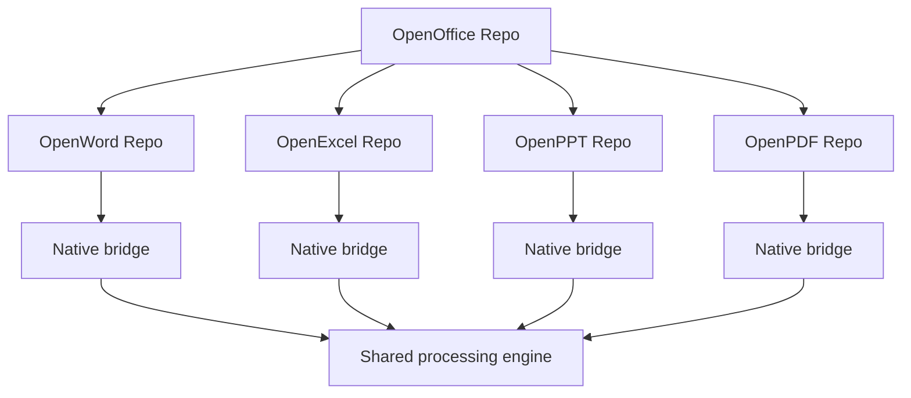

# OpenOffice


Thin all-in-one host that bundles OpenWord, OpenExcel, OpenPPT, and OpenPDF into a single binary. All four Office format handlers are built into a single binary — no separate engines to install.

Each sub-product (OpenWord, OpenExcel, OpenPPT, OpenPDF) is also independently installable. OpenOffice exists so you can ship one binary that covers all Office formats.

## 🧩 Architecture



## 📦 Product Matrix

| Product | Scope | Independent Repo |
|---------|-------|-----------------|
| OpenOffice | Thin bundle — one binary, all four modules | This repo |
| OpenWord | `.docx` parse, create, convert | `OpenWord` |
| OpenExcel | `.xlsx` read/write, formulas, pivots | `OpenExcel` |
| OpenPPT | `.pptx` generate and template fill | `OpenPPT` |
| OpenPDF | PDF generate, merge, split, metadata | `OpenPDF` |

## What's NOT here

- **No comprehensive test fixtures** — only minimal smoke tests exist here. Detailed conformance, fixtures, and acceptance scripts stay with each downstream product.
- **No heavy GUI** — this repo is a thin shell. If a desktop UI ships, it is built on top of the native bridge in each sub-product.

## 🚀 Usage (placeholder)

```bash
# Inspect a document without launching the full suite
open-office inspect path/to/report.docx

# Convert between formats
open-office convert input.xlsx output.pdf

# Launch the bundled GUI (when available)
open-office gui
```

## 🧱 Repo layout

```
OpenOffice/
├── package.json
└── Readme.md
```

This is a scaffold repo. The CLI entry points and native bridge wiring are added incrementally as each sub-product matures.
