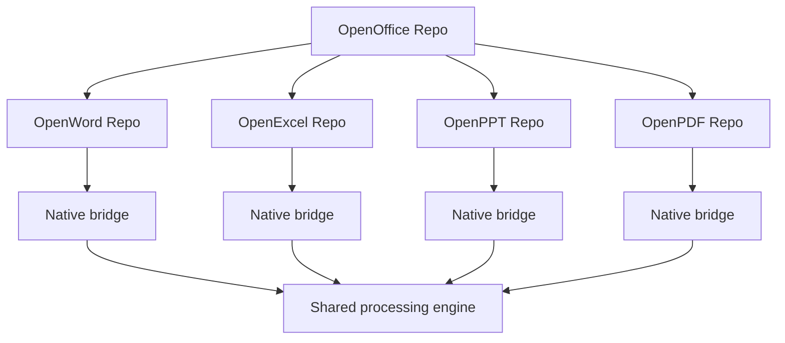

# OpenOffice


Thin all-in-one host that bundles OpenWord, OpenExcel, OpenPPT, and OpenPDF into a single binary. All four Office format handlers are built into a single binary — no separate engines to install.

Each sub-product (OpenWord, OpenExcel, OpenPPT, OpenPDF) is also independently installable. OpenOffice exists so you can ship one binary that covers all Office formats.

## 🧩 Architecture



## 📦 Product Matrix

| Product | Scope | Independent Repo |
|---------|-------|-----------------|
| OpenOffice | Thin bundle — one binary, all four modules | This repo |
| OpenWord | `.docx` parse, create, convert | `OpenWord` |
| OpenExcel | `.xlsx` read/write, formulas, pivots | `OpenExcel` |
| OpenPPT | `.pptx` generate and template fill | `OpenPPT` |
| OpenPDF | PDF generate, merge, split, metadata | `OpenPDF` |

## What's NOT here

- **No comprehensive test fixtures** — only minimal smoke tests exist here. Detailed conformance, fixtures, and acceptance scripts stay with each downstream product.
- **No heavy GUI** — this repo is a thin shell. If a desktop UI ships, it is built on top of the native bridge in each sub-product.

## 🚀 Usage

```bash
# Build the single binary (path dependencies on the four sibling repos)
cargo build --release -p open-office

# Show what every bundled engine actually supports
open-office capabilities

# Inspect a document through its owning engine
open-office inspect path/to/report.docx
open-office inspect path/to/budget.xlsx
open-office inspect path/to/deck.pptx
open-office inspect path/to/paper.pdf

# Convert with an explicit target format
open-office convert notes.md --format pdf --out notes.pdf
open-office convert budget.xlsx --format csv --out budget.csv
open-office convert deck.pptx --format pdf --out deck.pdf
open-office convert paper.pdf --format md --out paper.md
```

`inspect` returns the engine's own JSON report: word summary, statistics and
rule checks; workbook summary and checks; deck summary and import losses; PDF
version, page geometry, metadata, bookmarks and form fields. `convert` refuses
targets the source engine cannot write and never overwrites without
`--overwrite`.

Supported conversion targets:

| Source | Targets |
|--------|---------|
| Word (`.docx`, `.docm`, `.rtf`, `.md`, `.html`, `.txt`, `.oword`) | `docx`, `pdf`, `html`, `md`, `txt`, `rtf` |
| Excel (`.xlsx`, `.xlsm`, `.csv`, `.tsv`, `.oexcel`) | `xlsx`, `csv`, `tsv`, `json`, `html`, `pdf` |
| Presentation (`.pptx`, `.pptm`, `.ppsx`, `.ppsm`, `.potx`, `.potm`, `.project`, `.oppt`) | `pptx`, `ppsx`, `potx`, `pdf` |
| PDF (`.pdf`) | `md`, `txt` |

## 🧱 Repo layout

```
OpenOffice/
├── Cargo.toml
├── projects/
│   ├── crates/office/      # open-office binary, four-engine dispatch
│   └── sub_projects/       # shared scaffold crate
└── readme.md
```

The binary links the sibling repositories through path dependencies; it does
not copy their models or re-implement a format adapter.
